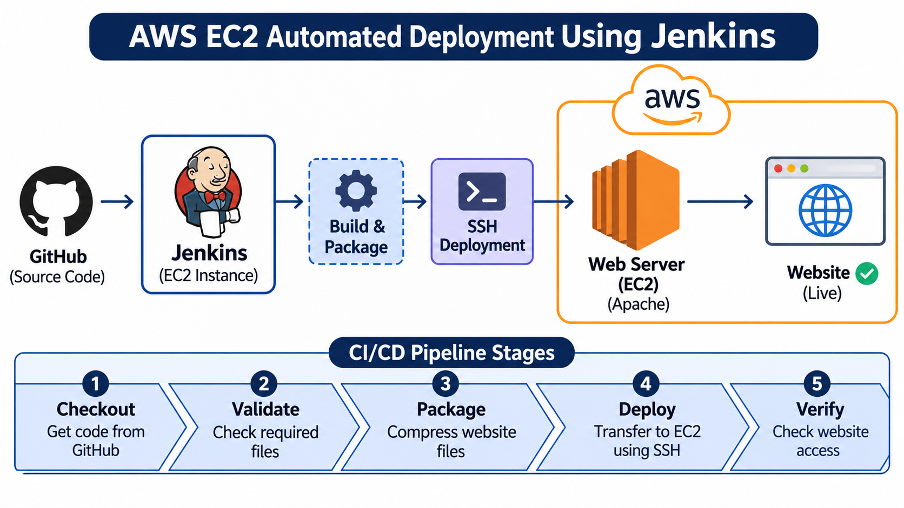

 
<h1 align="center">AWS EC2 Automated Deployment Using Jenkins</h1>

<h2>Project Overview</h2>

This project demonstrates an automated Continuous Integration and Continuous Deployment (CI/CD) pipeline using Jenkins and AWS EC2.

The pipeline fetches website source code from GitHub, validates the required files, packages the website, and deploys it to an Apache web server hosted on an AWS EC2 instance.

<h2>Project Objective</h2>

To automate the website deployment process using Jenkins and AWS EC2, reducing manual effort and improving deployment efficiency.

<h2>Technologies Used</h2>

- AWS EC2
- Jenkins
- Git and GitHub
- Ubuntu Linux
- Apache Web Server
- Shell Scripting
- SSH

<h2>Architecture</h2>

<h2>Project Architecture</h2>

  

<h2>CI/CD Pipeline Stages</h2>

1. <b>Checkout:</b> Jenkins retrieves source code from the GitHub repository.
2. <b>Validate:</b> Checks whether the required website files are available.
3. <b>Package:</b> Creates a compressed archive of the website files.
4. <b>Deploy:</b> Transfers the website package to the Web Server EC2 instance using SSH.
5. <b>Verify:</b> Checks whether the deployed website is accessible.

<h2>Project Structure</h2>

<pre>
aws-ec2-automated-deployment/
│
├── Jenkinsfile
├── README.md
│
└── website/
    ├── index.html
    └── style.css
</pre>

<h2>How It Works</h2>

- Source code is maintained in GitHub.
- Jenkins connects to the GitHub repository.
- The pipeline executes the defined stages.
- Website files are packaged and transferred to the Web Server EC2 instance.
- Apache serves the deployed website.

<h2>Learning Outcomes</h2>

- Jenkins pipeline creation.
- GitHub integration with Jenkins.
- AWS EC2 instance management.
- Automated website deployment.
- SSH-based remote server communication.
- CI/CD workflow implementation.

